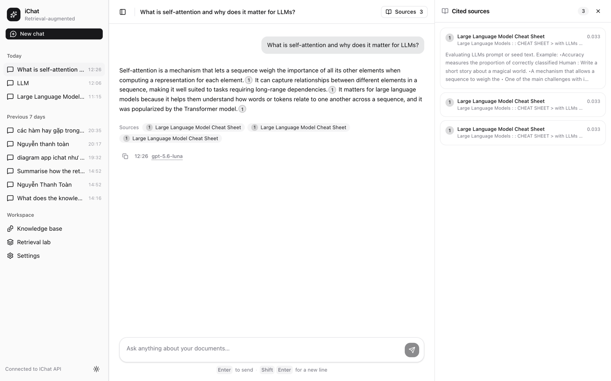
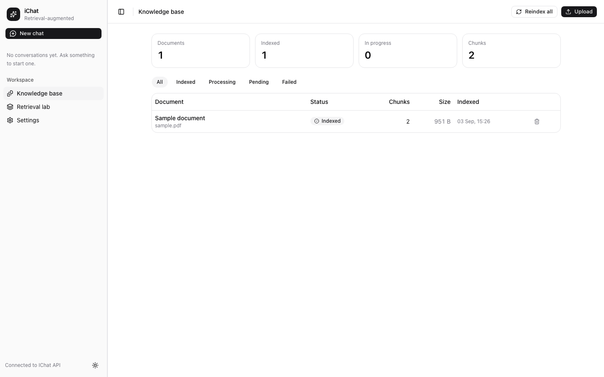
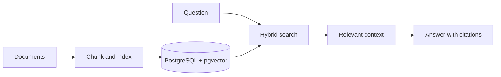
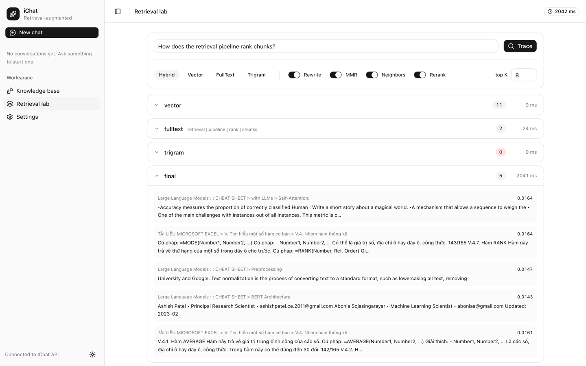

# iChat

**Turn your documents into a cited AI assistant.** iChat answers questions using the documents you upload, links answers back to their sources, and says when it can’t find relevant information.

.NET 10 · Angular 22 · PostgreSQL + pgvector · OpenAI



## Quick start

You’ll need Docker Compose and an OpenAI API key. Copy the example environment file, replace the sample keys, then start the app:

```bash
cp .env.openai.example .env.local
# Set Ai__Chat__ApiKey and Ai__Embedding__ApiKey in .env.local
docker compose --env-file .env.local up --build
```

Open the app at <http://localhost:4200>. The API is at <http://localhost:8080>; API docs are available at `/docs` in Development.

## Get started

1. Upload `PDF`, `DOCX`, `MD`, or `TXT` files in **Knowledge Base**.
2. Wait for indexing to finish.
3. Ask a question in **Chat** and open citations to inspect the source passages.
4. Use **Retrieval Lab** to see how iChat finds relevant content.



## How it works

iChat splits documents into chunks, creates embeddings, and stores them in PostgreSQL. For each question, it combines semantic, keyword, and fuzzy search, then uses relevant passages to generate a cited answer.



## What’s included

- **Chat:** streaming answers with sources and citations.
- **Knowledge Base:** upload documents, track indexing, and reindex when needed.
- **Retrieval Lab:** inspect search stages, candidates, and timings.
- **Settings:** check AI provider and model configuration.



## Configuration and development

Configure models, API keys, and RAG options in `.env.local` and `api/src/IChat.Api/appsettings.json`. Keep real API keys out of source control.

Run the backend and tests from the repository root:

```bash
docker compose up postgres api
(cd api && dotnet test)
(cd ui && npm test)
```

| Path | Description |
| --- | --- |
| `api/` | .NET API, document processing, search, and chat |
| `ui/` | Angular web app |
| `scripts/` | Operational tools |
| `IChat.md` | Detailed design notes (Vietnamese) |

See [`api/README.md`](api/README.md) for backend details and [`ui/README.md`](ui/README.md) for the frontend.

## Before deploying

This project is under active development. Configure authentication and secure the JWT signing key, API keys, data, and deployment environment before using it in production.
